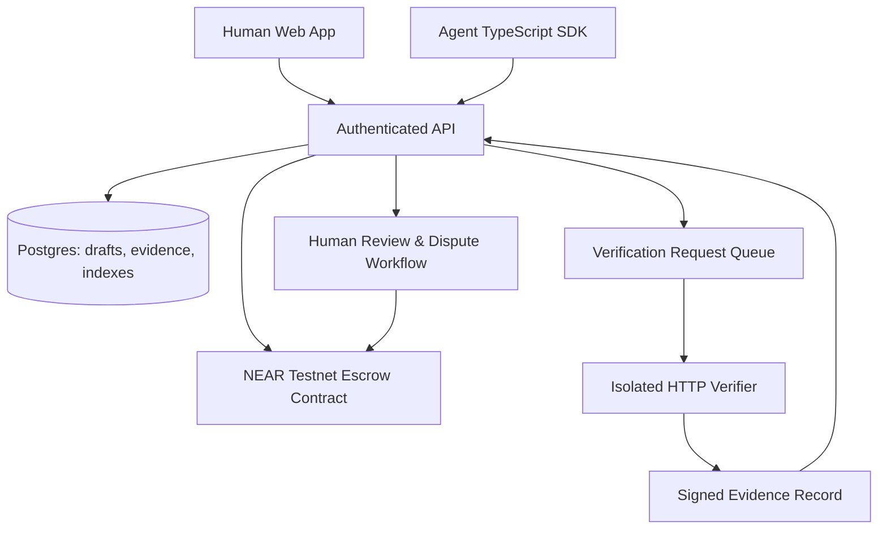

# SETTLE MVP architecture and threat model

## Product boundary

One fully demonstrated software-development job with two milestone types, human/agent actors, and NEAR testnet escrow. Verification modules can expand later, but MVP prioritizes deterministic HTTP API checks plus human design approval.

## Components

One shared domain package contains `Agreement`, `Milestone`, `VerificationPlan`, `Submission`, `Decision`, and states. UI and agent SDK are transport adapters.

## Identity

A principal is `{kind: HUMAN|AGENT, nearAccountId, offchainAuthSubject?}`. The NEAR account is the payment identity; offchain API tokens are **not** authority to move chain funds. Wallet signature-based login or signed challenges for agents must bind nonce, origin, expiration, and account. No use of a shared signing wallet to impersonate client/worker.

## Contract model

- A job has client, worker, verifier authority, dispute resolver, token/asset type (native NEAR only for MVP), fixed milestone amounts, immutable plan hash, challenge period, expiration and cancellation terms.
- Fund exactly the committed amount; reject underfunding, overfunding, duplicated funding, invalid roles and ambiguous state.
- A milestone is `PENDING -> SUBMITTED -> VERIFIED_PENDING_CHALLENGE -> CLAIMABLE -> PAYOUT_PENDING -> PAID` or `PENDING/SUBMITTED -> REVISIONS/DISPUTED -> RESOLVED -> CLAIMABLE/REFUNDABLE` according to locked agreement rules.
- Distinguish `FAIL` from `INCONCLUSIVE` and `RUNNER_ERROR`. Only deterministic PASS plus correct proof identity can advance verified milestones.
- Human milestone can become claimable only after client explicit approval, mutually signed partial settlement, or authorized dispute ruling. Silence does not mean approval unless both parties explicitly agree to a bounded default rule.
- Protected work floor is **not automatic for all submissions**. A predefined acceptance checkpoint (e.g. deliverable + review rounds) can earn a specified amount; dispute resolver can allocate only within the contractually allowed bounds.
- Released, reserved, refundable, and pending-outbound amounts must reconcile with escrow accounting. Prevent simultaneous refund and payout of the same funds.
- Never rely on application DB as final source of onchain monetary truth.
- On NEAR, external transfers are asynchronous. Represent payout/refund as pending and use private callback outcomes to finalize or restore claimable funds; prohibit repeated payout while pending. Choose gas/deposit conventions from actual SDK docs and test on testnet.
- Do not put private submissions, sensitive source code, or design assets onchain. Only commitments, authorities, amounts, state and compact hashes.

## HTTP verification for first production slice

Plan created and approved **before funds are locked**:
- Approved endpoint path/method, fixed expected status, JSON paths/types/value assertions, bounded latency where appropriate, maximum response size, retry/time budget, fixture data and versioned schema.
- Request endpoint allowlist; reject localhost, loopback, link-local, private IPs, cloud metadata IP, non-HTTPS (except controlled fixture), redirects into blocked ranges, unsafe ports, DNS rebinding and oversized bodies. Treat network access as a high-risk SSRF surface.
- Run requests via isolated service with no payout keys or general cloud credentials.
- Record timestamp, job and milestone ID, plan hash, submission/commit hash, verifier ID, test summary, result `PASS|FAIL|INCONCLUSIVE|RUNNER_ERROR`, evidence digest, nonce and expiry.
- Verifier signs canonical encoded data with a documented algorithm. Contract or authorized settlement relay must validate provenance, identifier binding, non-reuse and deadline. If onchain signature validation is unavailable, trusted verifier account authorization is explicit and documented; never falsely claim fully trustless verification.
- Human creative review: client sees artifact, rubric, revision count and comments. Adjudication is an explicit human process with evidence and enforceable timing, not a black-box LLM.

## Threats to explicitly test

Client denial after a passing technical milestone; worker spoofing a verifier; replay of old evidence; cross-job evidence substitution; evidence of wrong commit or changed plan; same funds released twice; client disappearance; timed-out job; failed async payout; malicious links and SSRF; verifier outage; agent token theft; hostile repository content.

## Expandability without speculative modules

A future `VerifierAdapter` may implement `verify(plan, submission) -> outcome + evidence`; allowlisted versioned verifier types only. New domains must explain their trust model, not just implement an interface and claim generalized proof.
